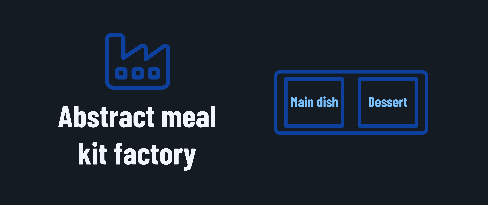
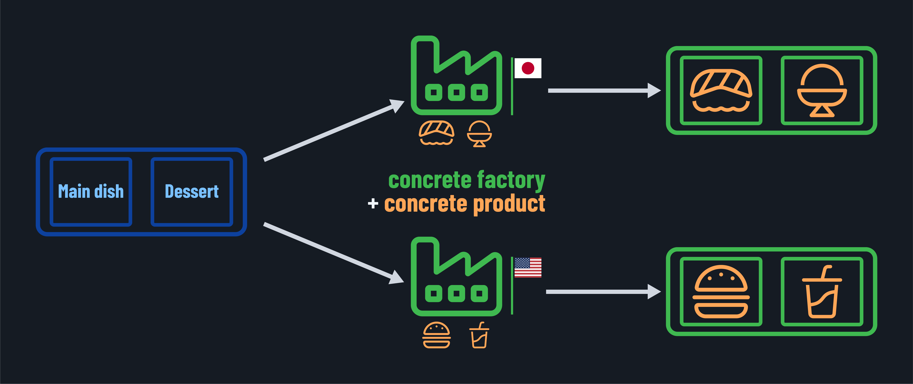
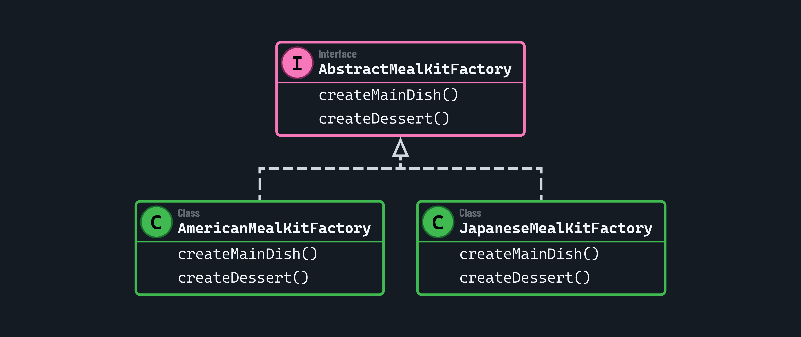
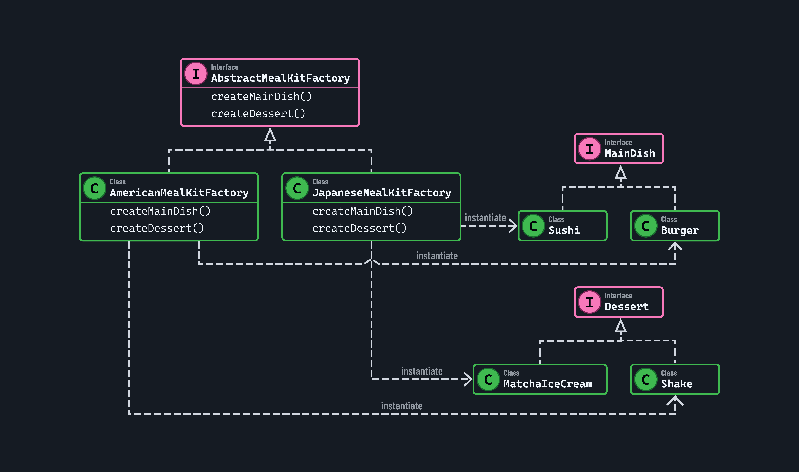
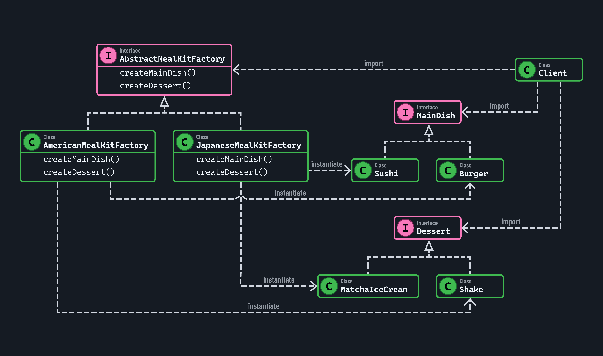

<h1>
  Factory Design Patterns in Java
  Abstract Factory Pattern
</h1>

**Learning objective:** By the end of this lesson, you'll be able to identify the problem contexts, during your programming tasks, in which the abstract factory design pattern is the best solution.

## Abstract factory design pattern

We often need to work with different groups of related objects in apps, but we don't want our code to depend on their specific classes. The *abstract factory* pattern helps us achieve this.

For example, say we want to build meal kits. Each meal kit will always come with a main dish and a dessert. We can use an abstract factory (which is an interface or abstract class) that knows how to create meal kits but doesn't know the specifics of the actual meals that go into each kit.

### Concrete factories and products

Instead, it leaves those specifics to *concrete factories*. These classes are responsible for producing the actual objects by instantiating *concrete products*. Concrete factories know the actual meals that go into each kit!

Multiple concrete factories can implement the same abstract factory's interface. This makes them valuable since they allow us to implement different groupings of related objects without modifying the abstract factory. It's also why the abstract factory pattern is often called a "factory of factories".

Returning to our meal kit example, one concrete factory may produce American food (like a burger for the main dish and a shake for dessert). Another concrete factory could make Japanese food (like sushi for the main dish and matcha ice cream for dessert).

## Technical implementation

Getting more technical, an abstract factory is an interface or abstract class with methods that define how each type of object in the family is created. Our meal kits may be produced by an `AbstractMealKitFactory`, which has method signatures for creating each type of product (like `createMainDish()` and `createDessert()`) without specifying the concrete products themselves.

The *concrete factory* is a class that implements the `AbstractMealKitFactory` interface to produce the final objects. In our example, we might have two concrete factories: `AmericanMealKitFactory` and `JapaneseMealKitFactory`.

Concrete factories fill in the blanks an abstract factory provides by instantiating *concrete product* classes. An example of a *concrete product* class in our meal kit factory would be a `Sushi` or `Burger` class.

These *concrete product* classes implement *product interfaces*. In our example, both the `Sushi` and `Burger` classes would implement a `MainDish` interface.

### Adding to an abstract factory

Say we want to add a new meal kit group for Dutch food. We'd create a new `DutchMealKitFactory` that implements the existing `AbstractMealKitFactory` interface and have it create new concrete products - `Stamppot` for the main dish and `Stroopwafel` for dessert.

`Stamppot` would implement the `MainDish` product interface, which already exists and is used by the other main dishes. The same applies to the `Stroopwafel` class - it would implement the `Dessert` product interface instead.

We would follow this pattern for every new meal kit group we create. Our existing factories don't need to change just because we add a new one.

### Using an abstract factory in a client application

This is all great, but how would it be implemented in a product?

We've seen how abstract factories allow us to swap groups of objects just by changing the concrete factory used to instantiate the final products. This has multiple applications, but a widespread implementation is in UI design.

For example, if we need to handle different UI components based on a selected theme, an abstract factory can produce the right components for that theme without forcing any changes in our client code.

This is because our client code only needs to know about the interfaces, not specific classes. We don't need to rewrite the client code if we change how any of the product classes work internally. This results in our UI system being flexible and maintainable as we grow and adjust our codebase over time, allowing us to easily construct as many themes as we might need in a project.

## Considerations

The abstract factory design pattern does have some pitfalls that you should be aware of before implementing it:

- **Extra complexity**: Setting up interfaces, abstract classes, and multiple concrete classes means more initial work and more to maintain over time.
- **Limited flexibility at the product level**: While swapping entire families is straightforward, this approach can be less flexible if we want to add or change just one product.
- **Coupling to the factory interface**: Everything relies on the abstract factory's interface. If it changes, we will likely need to update every concrete factory.
- **Effort to add new families**: Creating a brand-new family of products involves writing new concrete classes and a new factory, which may be time-consuming.

### Abstrct factory design pattern components
- **Abstract product interfaces**: Define families of products.
- **Concrete product classes**: Implement the abstract product interfaces.
- **Abstract factory interface**: Declares methods for creating abstract products.
- **Concrete factories**: Implement the abstract factory to produce products of a particular family.

### Most suitable problem contexts to use abstract factory design pattern
- When the application requires creating families of related products.
- To enforce consistency between products.
- When we need to provide a layer of abstraction for creating product families.

### When NOT to use abstract factory design pattern
- When there’s no need to create families of products.
- When the application complexity outweighs the benefits of adding abstract factory logic.