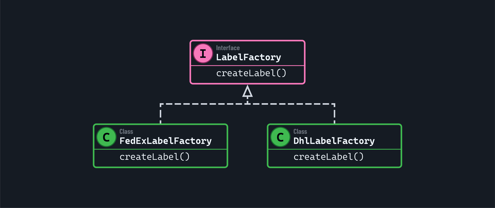
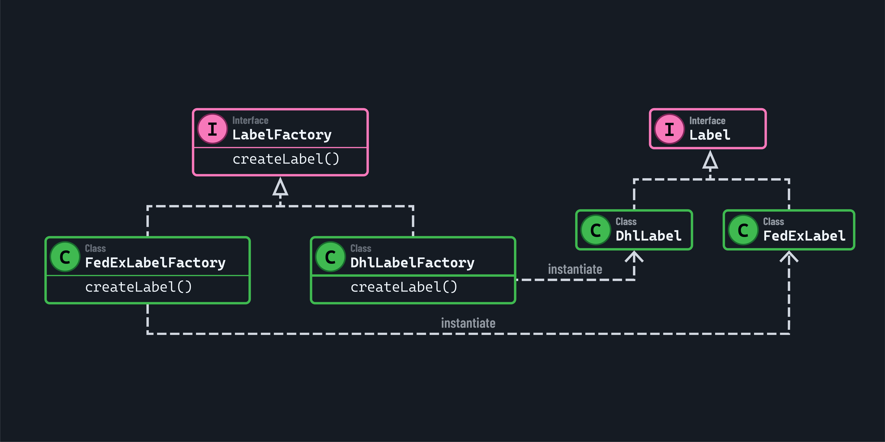

<h1>
  Factory Design Patterns in Java
  Factory Method Pattern
</h1>

**Learning objective:** By the end of this lesson, you'll be able to identify the problem contexts, during your programming tasks, in which the factory design pattern is the best solution.

## Factory method pattern

Imagine you were building an app to generate various shipping labels. Each label might differ based on the carrier or the destination's region. Creating these labels directly in your code — by always specifying which label to instantiate — could make it harder to adapt as your shipping needs grow.

This is where the factory method pattern comes in. Instead of deciding which label class to create within your main code, you rely on a dedicated *factory method* to handle it. By using this approach, you can introduce new label types, like for a new carrier, without forcing changes in the rest of your application. This can make the codebase easier to maintain and update.

### Technical implementation

Our factory method pattern will start with an abstract class or interface that declares a method responsible for creating an object. Using our label-making app as an example, we may make a `LabelFactory` interface with a method called `createLabel()`.

*Concrete classes* that implement the `LabelFactory` interface will have this `createLabel()` method to return different types of labels.

The labels that the concrete classes instantiate are *concrete products*, for example the `FedExLabelFactory` may instantiate a label suited for FedEx shipments, like `FedExLabel`. The `DhlLabelFactory` would instantiate a DHL-compatible label like `DhlLabel`.

These concrete products are classes that would all implement a shared interface like `Label`.

The decision to create a specific type of label is encapsulated in these subclasses, so the rest of your code does not need to know which carrier's label it gets. It should only care that it receives something that meets the `Label` interface.

To add a new carrier, we would create a new concrete that returns the appropriate label object.

By abstracting this choice behind a factory method, we also keep our client code focused on what it needs to achieve rather than how to achieve it. This reduces coupling between your client code and any specific label class.

As a result, if you need to adjust how labels are created — such as by creating a new shipping policy or a special label format — you can do so in a single place.

### Factory design pattern components
- **Product Interface (or Abstract Class)**: The common interface for all concrete product types.
- **Concrete Products**: The specific classes implementing the product interface.
- **Factory Class**: Contains the logic to instantiate the appropriate concrete product.

### Most suitable problem contexts to use factory design pattern
- When the client code should not care about the exact class of object to be created.
- To simplify complex or repetitive object creation logic.
- When we need to decouple object creation logic from client code.

### When NOT to use factory design pattern
- When the object creation is very simple and doesn’t require abstraction.
- If we need to frequently modify the factory logic to accommodate new object types (may lead to maintenance issues).